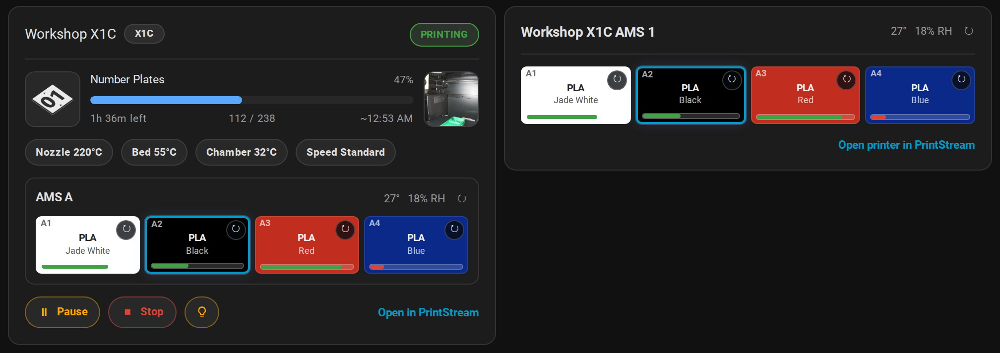

# PrintStream for Home Assistant

Brings the printers you run with [PrintStream](https://github.com/PrintStreamApp/printstream), the self-hosted print farm manager for Bambu Lab printers, into Home Assistant; learn more at [printstream.app](https://printstream.app).



**Live printer state:** sensors for status, current job, progress, layer, remaining time, temperatures, fans and Wi-Fi signal, updated from PrintStream's live event stream with no polling.

**AMS and spools:** each AMS unit is a device with humidity, temperature, drying state and a sensor per slot for material, colour and remaining filament, plus external spools.

**Cameras and images:** a live camera entity for camera-capable printers, relayed through PrintStream, and image entities for the job's cover and the latest snapshot.

**Dashboard cards:** printer, AMS and media cards register themselves, with no resource to add by hand.

**Controls:** services to pause, resume and stop a print, refresh a printer or AMS, switch the chamber light, clear printer errors and rescan an AMS slot.

**Library:** your PrintStream library appears in Home Assistant's media browser.

**Model-aware entities:** sensors are created only for what your printer or AMS reports, such as per-nozzle readouts on dual-nozzle models, AMS drying, and door, duct and light state.

## Requirements

- Home Assistant 2024.11.0 or later.
- A PrintStream server, version 1.0.6 or later, that Home Assistant can reach.
- The **Home Assistant** plugin enabled in PrintStream for the workspace you want to connect.

## Installation

### HACS (recommended)

1. In HACS, open the menu and choose **Custom repositories**.
2. Add `https://github.com/PrintStreamApp/printstream-home-assistant` with the type **Integration**.
3. Install **PrintStream**, then restart Home Assistant.

### Manual

Copy `custom_components/printstream` into your Home Assistant `config/custom_components/` folder, then restart Home Assistant.

## Setup

1. In PrintStream, open **Settings**, then **Plugins**, enable **Home Assistant** for your workspace, and choose **Create access token** in the plugin's panel. The token carries the printer, AMS, camera and library access the integration needs, and PrintStream warns you if it is later revoked.
2. In Home Assistant, go to **Settings**, **Devices & services**, **Add integration**, and search for **PrintStream**.
3. Enter a name, your PrintStream server's URL and the access token.

Printers and AMS units appear as devices. You can add more than one PrintStream entry, for example one per workspace. To change an entry's name, URL or token later, choose **Reconfigure** from its menu. If PrintStream stops accepting the token, for example after it is revoked, Home Assistant asks you to re-authenticate: create a new token in the plugin's panel and enter it there. **Download diagnostics** in the same menu gives you a file to attach to an issue, with the token, serial numbers and addresses removed.

## Dashboards and services

The cards are `custom:printstream-printer-card`, `custom:printstream-ams-card` and `custom:printstream-printer-media-card`. Each takes the status sensor of a printer or AMS unit as its entity, and the card editor offers the first one it finds:

```yaml
type: custom:printstream-printer-card
entity: sensor.workshop_x1c_status
```

The services are in the `printstream` domain: `pause_print`, `resume_print`, `stop_print`, `refresh_printer`, `refresh_ams`, `clear_hms_errors`, `set_chamber_light` and `rescan_ams_slot`. Each targets a PrintStream entity; **Developer tools**, **Actions** lists their fields.

## Issues

Report problems at <https://github.com/PrintStreamApp/printstream-home-assistant/issues>. Include the integration, Home Assistant and PrintStream versions, and remove access tokens and server addresses from any logs you paste.

## Where development happens

This repository is generated from PrintStream's private source repository, where development happens, and is updated with each integration release. Issues and pull requests here are welcome; accepted changes arrive with the next release.

## License

Licensed under the **PolyForm Noncommercial License 1.0.0** (see [`LICENSE`](LICENSE)), copyright Ryan Ewen (see [`NOTICE`](NOTICE)). You may use, modify and share it for any noncommercial purpose; commercial rights are reserved.

[Website](https://printstream.app) · [Terms of Service](https://printstream.app/terms) · [Privacy Policy](https://printstream.app/privacy)
